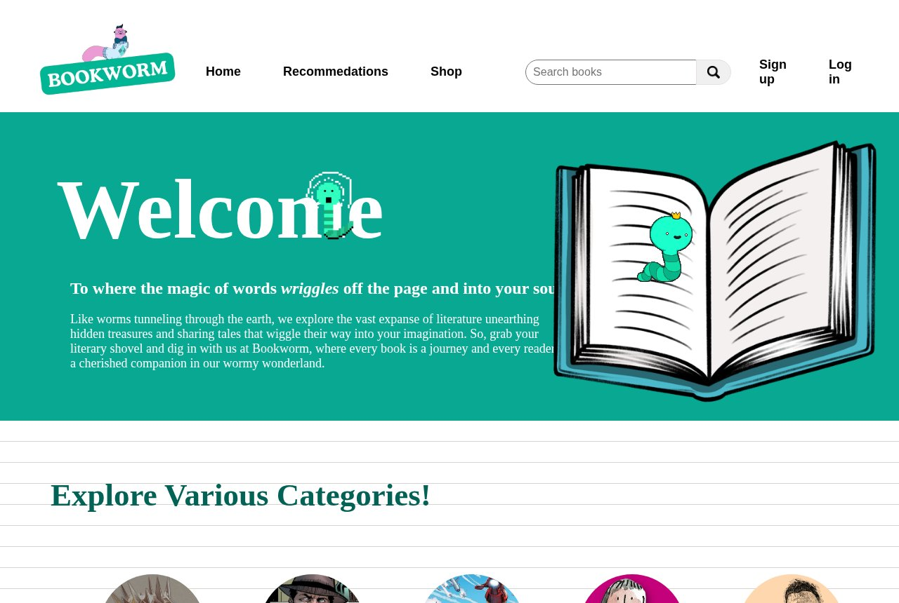
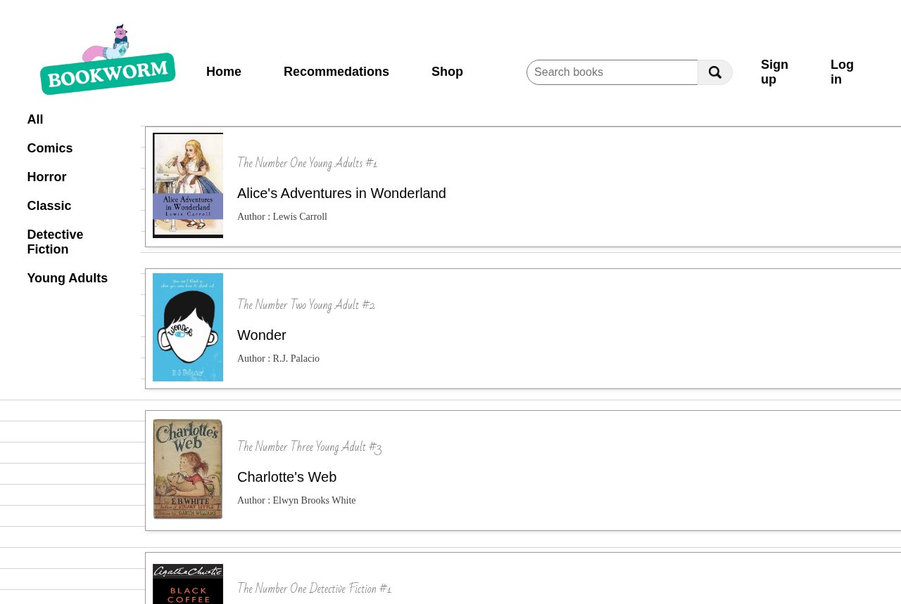
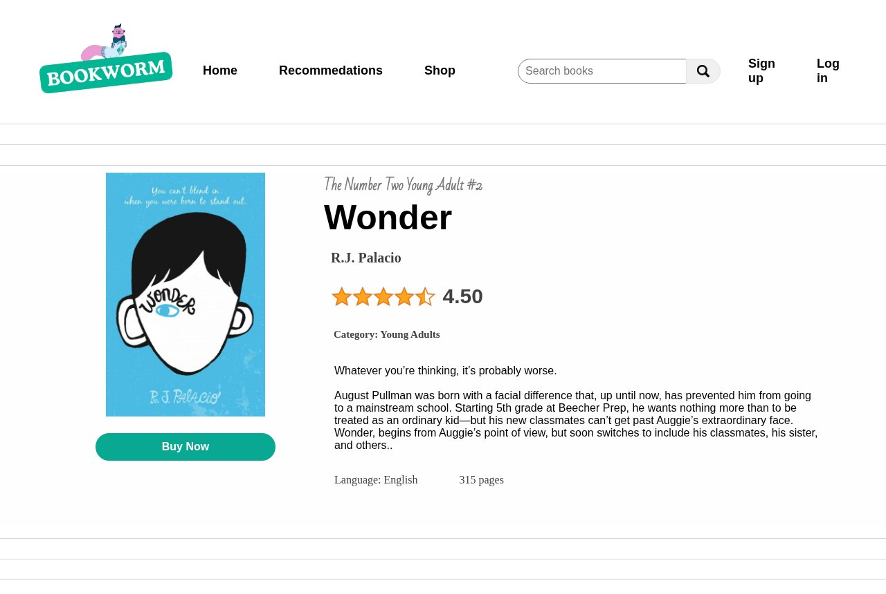
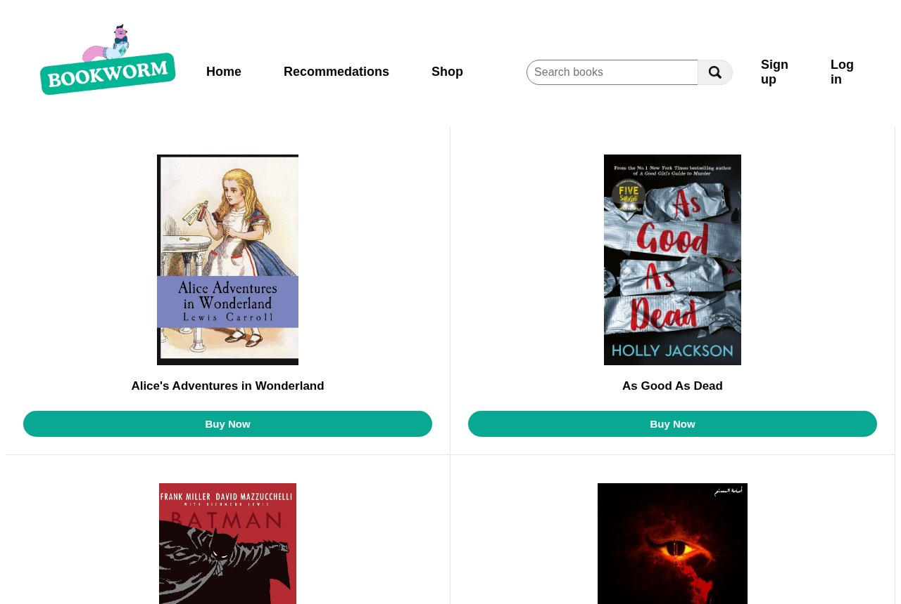

# BookWorm – Online Bookstore Website

> A multi-page bookstore website for browsing books by category, reading synopses and reader reviews, and jumping to trusted online retailers to buy.



## Overview

**BookWorm** is a front-end website for book lovers. Visitors explore genre categories, open a page for each book with its cover, author, rating, synopsis, language and page count, read reader reviews, and use **Buy Now** to choose a retailer (Amazon, Jarir, AbeBooks, Barnes & Noble, Bookshop, Virgin Megastore and others).

It was built for the *Advanced Web Programming* course. The phase 1 report ([`docs/BookWorm_Report.pdf`](docs/BookWorm_Report.pdf); student IDs removed) designed the wider platform: user roles, a database model and an ER diagram. This repository contains the implemented **HTML/CSS/JavaScript front-end**.

## Features

- **Home page:** a hero section, category shortcuts with hover pop-ups, five featured books and reader reviews
- **Categories:** Classic, Comic, Detective Fiction, Horror and Young Adults, each with its own page
- **15 book detail pages**, for example *Wonder*, *Little Women*, *Sherlock Holmes*, *The Shining*, *Batman*, *Infinity Gauntlet*, *War and Peace* and *Holes*. Each page shows the cover, author, star rating, synopsis and metadata.
- **Dynamic reviews:** each book's reviews are rendered from a JavaScript data file, with reviewer avatars and star-rating images
- **Shop page:** a grid generated from `scripts/data-books.js`. **Buy Now** opens a pop-up with links to external stores.
- **Sign up and log in pages** (front-end forms only)
- A consistent header with navigation, a search bar and a footer across all pages

## Screenshots

| Categories | Book page |
|---|---|
|  |  |
| **Shop** | **Log in** |
|  |  |

## Tech Stack

- HTML5 and CSS3 (one stylesheet per page type in `Css/`)
- Vanilla JavaScript (data-driven rendering of reviews and the shop grid, pop-up modals)
- [Swiper 11](https://swiperjs.com/) is included via CDN for an (unused) carousel setup

## How to Run

Open `index.html`, which redirects to `home-page.html`, in a browser. You can also serve the folder:

```bash
python3 -m http.server 8000
# visit http://localhost:8000
```

All assets are local apart from the optional Swiper CDN.

## Project Structure

```
bookworm-bookstore/
├── index.html                 # redirects to home-page.html
├── home-page.html             # landing page
├── Categories*.html           # category listing pages
├── <book-name>.html           # 15 book detail pages
├── shop.html  login.html  sign-in.html
├── Css/                       # page stylesheets
├── scripts/
│   ├── data-books.js          # book data for the shop grid
│   ├── shop.js  pop-up.js     # shop grid + "where to buy" modal
│   ├── swiper.js              # Swiper config (no carousel markup yet)
│   └── review*.js             # per-book review data + rendering
├── images/                    # covers, authors, categories, avatars, store logos, icons
└── docs/
    ├── BookWorm_Report.pdf
    └── screenshots/
```

## Notes

- The sign-up, login, search and back-end features (users, favourites, review storage) described in the course design are not implemented. This is the front-end deliverable.
- Book covers, author photos and store logos belong to their respective owners and are used for educational purposes.

## Credits

Team project for **Advanced Web Programming (14014110-3)**, College of Computing, Umm Al-Qura University, 2024–2025.
Team members (from the course report): Shaima Mohammed Al-Khuzaee, Hala Mohammed Jalal, Razan Mohammed Hakimi, Lujain Khaled Al-Sayed, and Shahd Yousef Almatrouk.

## License

Code: [MIT](LICENSE) © 2025 Hala Jalal. Third-party images keep their own licenses.
